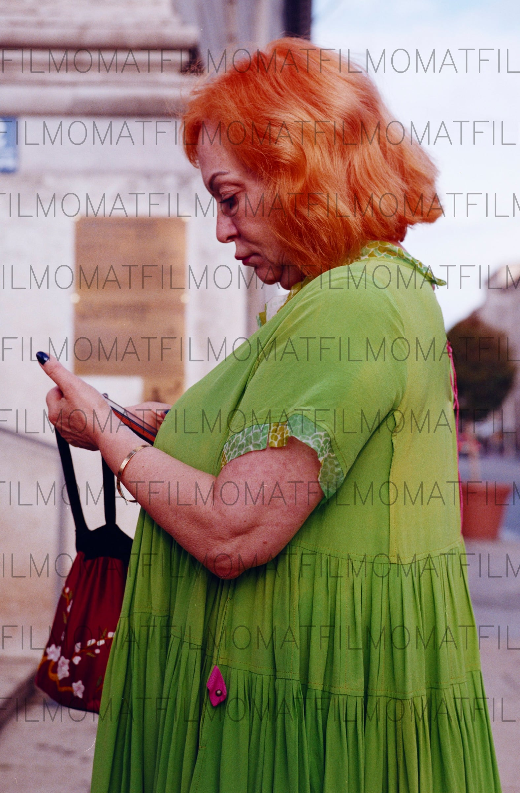
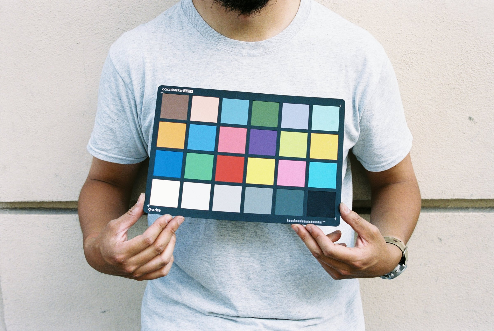
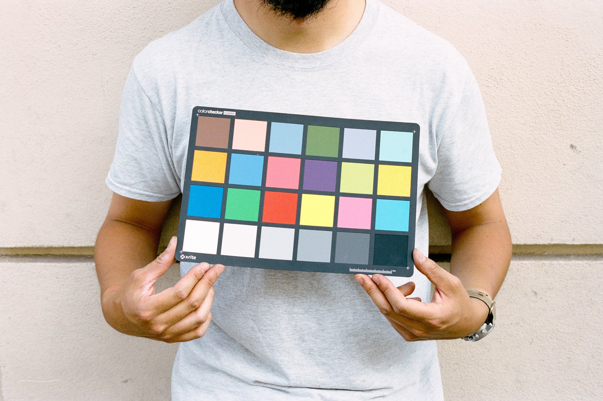
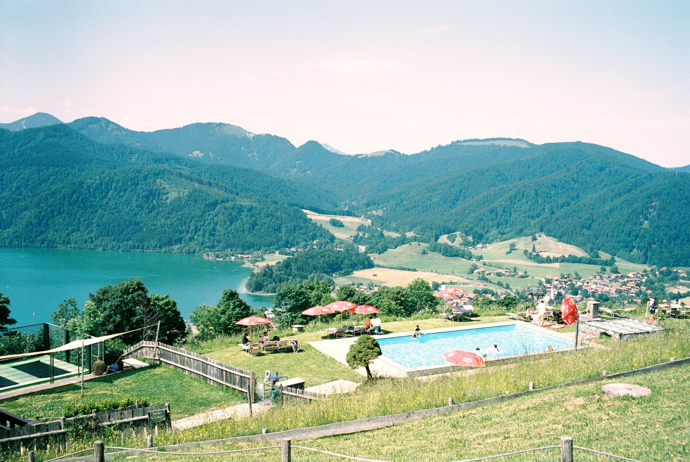
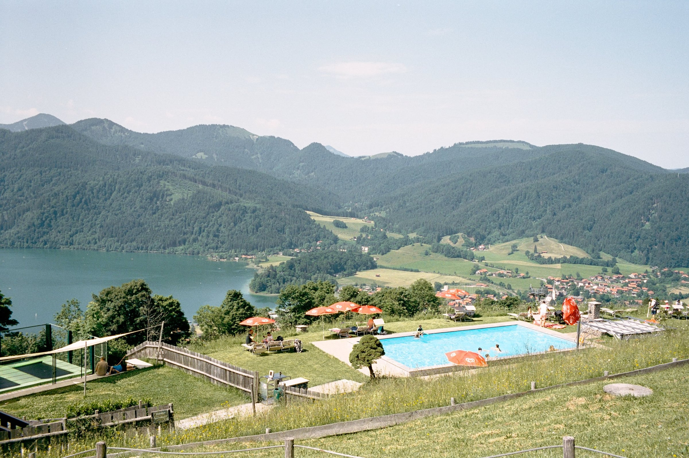
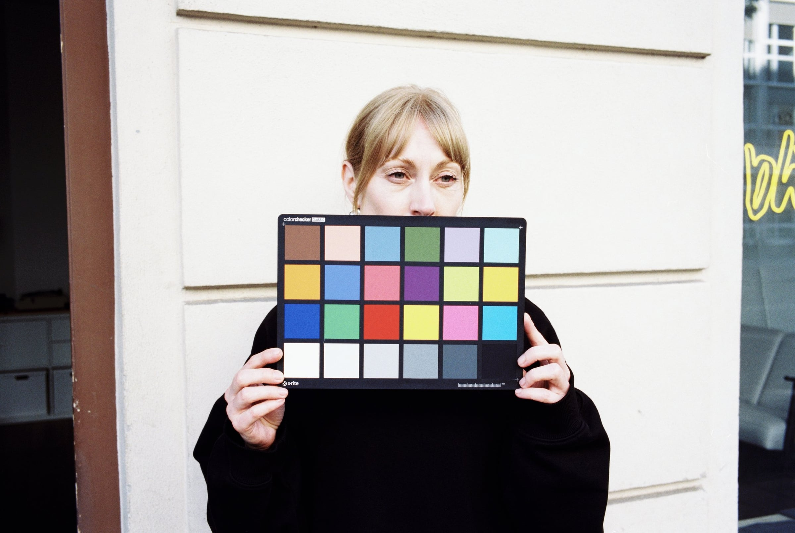
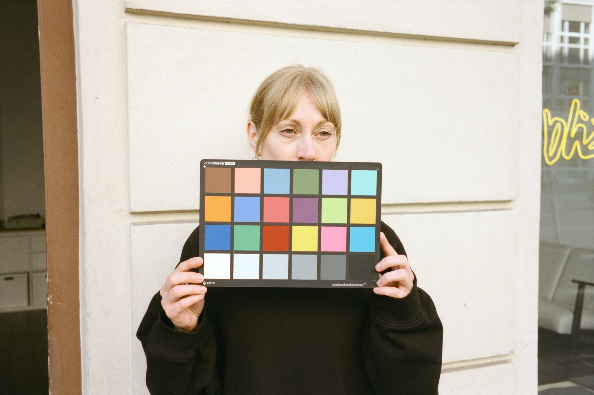

We’ve spent the last three or so years trying to get the best conversions out of film scans. I’ve tried pretty much every tool currently available, and whilst there are some very good options, none of them fully suit a photo lab workflow.

The difficulty lies in just how many variables there are with film: which stock it is, what exposure level, how expired it is, how it was stored, what chemistry it was developed in, the light source used, the scanner itself, the monitor calibration, the ambient lighting in the editing room, how tired the operator is and finally even who the operator scanning is (everyone sees and interprets colour differently).

This is why, in general, tools that have some kind of auto ranging and colour balancing tend to work well across many different film stocks — but not in every single case, and what we needed in a lab was something consistent.

The problems mostly show when you have strong under- or overexposure, X-ray damage, or heavily colour-biased images. Our classic problem example we call the “woman in a green dress”, where most of the frame is green — this throws off almost all tools that use auto levelling.

(Note that in the example here in Smart Convert, only the ‘auto white balance’ was used, and it would be very easy to correct the colour cast using the other tools.)

## The ‘profile’ approach

So after all this time, what we have settled on is an approach of creating a **conversion profile** for every film stock we regularly receive, and calibrating these profiles using images of colour charts taken across large exposure ranges, as well as ordinary scenes such as landscapes and portraits.

While this has been rather time consuming, it has meant that we have been able to produce consistent conversions across all film stocks. It also allows us to see clearly what is going on in each frame — when it strays from the profile, we know that the film may be expired, or the latent image faded etc., and we can then further correct these differences based on this knowledge.

## The Frontier question

Now, the danger of building a profile purely on colour charts is that you might “calibrate out” all of the native look of the film — and of course we don’t want this.

Now we get to the Frontier. The “Frontier look” is loved by many, as well as ourselves, so to make sure our images don’t lose their film soul, we further scanned all of our test rolls with a Fuji Frontier (SP-3000) and adjusted our conversions to stay aligned with the best parts of the Frontier scans (especially regarding skin tones), whilst retaining the dynamic range and colour accuracy of our own profiles.

*So why don’t we just buy a Fuji Frontier?*

- **Speed** — scanning and processing one roll on the Frontier can take as long as **14 minutes**.
- **Price and risk** — as of today, you generally can't get a Frontier (SP-3000) for less than around 6,000 euros, which is a lot for something that was made in the 90s, may have various issues that are hard to detect and may just completely stop working at any point.
- **Consistency** — while the Frontier does a great job on well-exposed stocks such as Kodak Gold and Portra, it tends to leave underexposed images very flat, or with strong green casts in the shadows. The Frontier also does not have built-in profiles for the cine film stocks that are common these days. You can see an example of Kodak Vision3 250D below.

## The comparison

Below are a few examples of the Frontier scans we made next to our own scans. (Note that there may be slight differences in white balance and contrast.)

### Portra 400

### Kodak Vision3 250D

### Kodak Gold 200

For us, this approach gives us the best of both worlds — the consistency and dynamic range of a modern workflow, with the soul of the Frontier look we all grew up loving.
