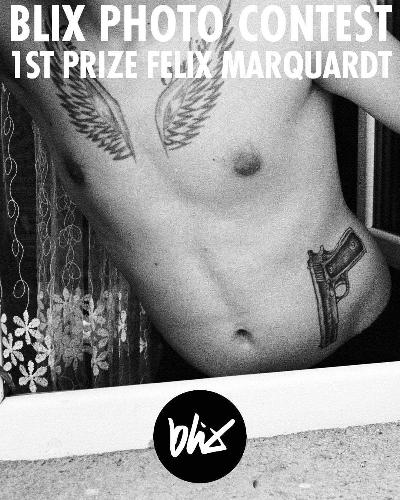
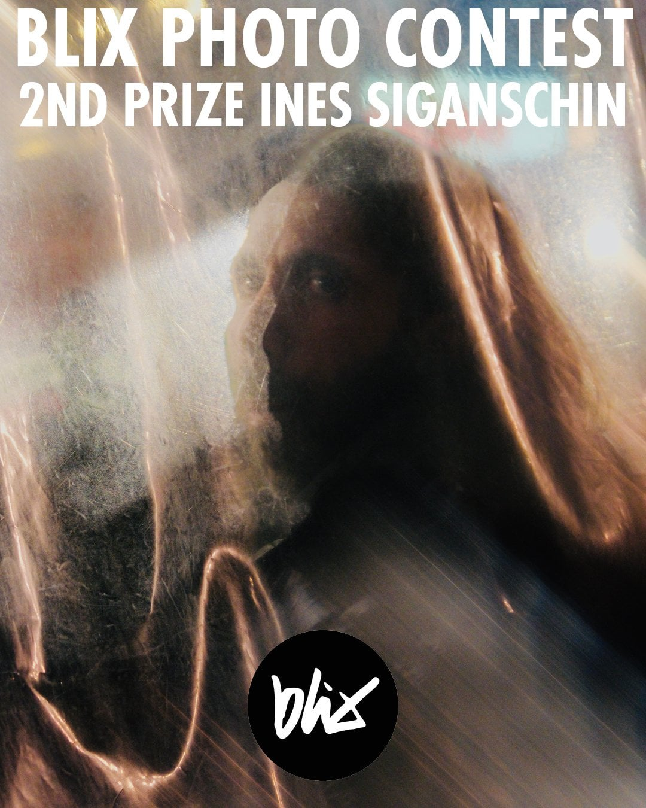
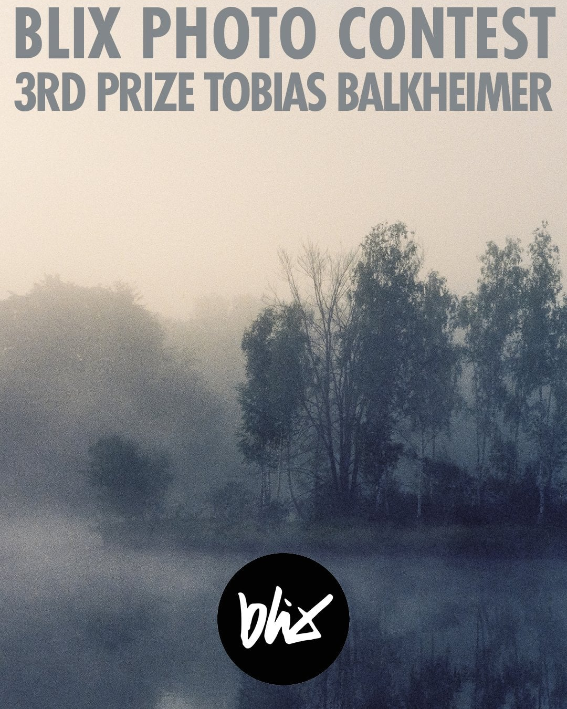

Von September bis November 2025 haben wir den ersten **blix Fotowettbewerb** veranstaltet. Ziel war es, Fotograf:innen dazu zu bringen, über das einzelne Bild hinauszudenken und stattdessen eine zusammenhängende Arbeit zu zeigen.

Gefragt waren **drei bis sieben Bilder** zu einem frei gewählten Thema, dazu ein kurzer Text über Konzept und Absicht der Serie. Eingereicht werden konnten **digitale wie analoge** Arbeiten. Worauf es ankam: eine klare Idee, Stimmigkeit und Tiefe.

Die Resonanz war groß. Wir haben **über 64 Einsendungen** bekommen – jede davon ein durchdachtes Projekt und nicht nur ein einzelnes Foto.

## Die Jury

Alle Einsendungen wurden anonym von den blix-Partner:innen bewertet, in zwei Runden.

In der ersten Runde ging es um Stimmigkeit, Abfolge und konzeptionelle Klarheit. In der zweiten haben wir eine kleinere Auswahl an Serien noch einmal angeschaut und ausführlich diskutiert. Am Ende zählten nicht nur einzelne starke Bilder, sondern ob die Arbeit als Ganzes eine überzeugende Geschichte erzählt.

Es war ein langer und kein leichter Prozess. Das Niveau war insgesamt hoch.

## Die Gewinner:innen

### 1. Platz – [Felix Marquardt](https://www.instagram.com/marquardtfelix/)

**Street Life in Sofia**

Felix fotografiert seit Anfang 2024 konsequent analoge Street Photography – in städtischen Räumen, in denen soziale Brüche sichtbar werden: Ungleichheit, Parallelwelten, Sucht und Obdachlosigkeit.

Die Gewinnerserie ist im Juni 2025 in Sofia entstanden. Die Fotos sind spontan und ohne Inszenierung entstanden. Mehrere der Porträtierten haben Einblicke in ihren Alltag gegeben, wodurch die Arbeit eine Nähe bekommt, ohne ausbeuterisch zu wirken.

Felix’ Ansatz ist roh und direkt. Seine Bilder sind ungefiltert und oft melancholisch, aber nie wertend. Die Abfolge erzählt stimmig vom Leben am Rand des städtischen Raums. Als Gesamtwerk war die Serie selbstbewusst, klar und eindringlich.

### 2. Platz – [Ines Siganschin](https://www.instagram.com/jessdiel/)

**Hinter den Scheiben der Stadt**

Ines’ Serie spielt größtenteils in München und erkundet flüchtige Momente von Nähe und Distanz – beobachtet durch Fenster, Glasflächen und durchscheinende Barrieren.

Ihr fotografischer Weg begann vor Jahren in der Schule, inspiriert von stark inszenierten und kontrollierten Bildern. Als sie 2023 zur Fotografie zurückkehrte, fand sie darin etwas anderes: Aufmerksamkeit, Ausgeglichenheit und Halt. Diese Haltung zieht sich durch die ganze Serie.

„Hinter den Scheiben der Stadt“ konzentriert sich auf kleine, leicht übersehene Momente. Inspiriert von der Idee, dass Bedeutung oft in winzigen, perfekten Fragmenten des Alltags liegt, lädt die Arbeit dazu ein, innezuhalten und wirklich hinzuschauen. Die Fotos sind zurückhaltend, aber bewusst gesetzt und spiegeln sowohl die Atmosphäre der Stadt als auch den persönlichen Blick der Fotografin.

Die Serie hat durch ihre Geschlossenheit und Feinfühligkeit überzeugt.

### 3. Platz – [Tobias Wimmer](https://www.instagram.com/tobiaswimmer_/)

**Invasive Species**

Tobias’ Serie begann an einem Spätsommermorgen Ende August. In einer vertrauten Landschaft an der Donau bemerkte er eine leise, aber vielsagende Veränderung: Drüsiges Springkraut breitete sich in Bereichen aus, die bisher vom Schilf beherrscht wurden.

Die Arbeit beschäftigt sich mit Wahrnehmung, Zeit und ökologischem Wandel. Was statisch wirkt, ist in Wahrheit im Übergang. Die Bilder halten einen Moment fest, der fast ausgeglichen wirkt – beinahe 50/50 –, aber eindeutig Teil eines längeren Prozesses ist. In seinem Begleittext hinterfragt Tobias das Fotografieren selbst: Drückt man aus geschultem Bildgefühl ab, aus Erinnerung oder aus dem Drang, etwas festzuhalten, das später einmal wichtig sein könnte?

Das Ergebnis ist eine ruhige, aber konzeptionell starke Landschaftsserie, die durch ihren Kontext an Gewicht gewinnt.

## Ausstellung bei blix

Alle drei Gewinner:innen haben eine **zweimonatige Ausstellung bei blix** bekommen. Wir haben die Prints produziert und in unseren Räumen aufgehängt – danach dürfen die Fotograf:innen die ausgestellten Prints behalten.

Eröffnet wurde die Ausstellung auf unserer **Blixmas-Party am 13. Dezember**. Zur Vernissage kamen Teilnehmende, Freund:innen und Besucher:innen – der Raum war voll und lebendig. Die drei Serien gedruckt, gerahmt und nebeneinander an der Wand zu sehen, hat gezeigt, wie stark die Projekte sind und wie viel es bringt, Arbeiten physisch zu präsentieren.

Der Fotowettbewerb 2025 hat gezeigt, wie viel Tiefe entsteht, wenn Fotograf:innen in Serien denken. Die Vielfalt an Themen und Herangehensweisen spiegelt die Vielfalt unserer Community.

Danke an alle, die mitgemacht und diese erste Ausgabe zu einem Erfolg gemacht haben.
